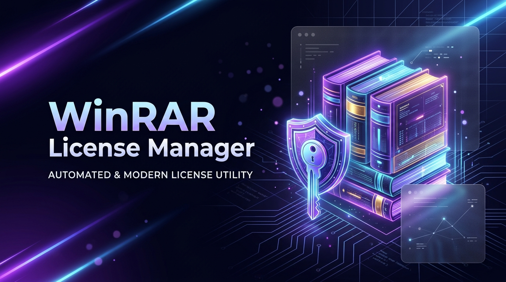

# WinRAR Activator — Trình kích hoạt WinRAR cho Windows 10/11

[English](README.md) | [Tiếng Việt](README_vi.md)

### ⚡ Cài đặt nhanh qua PowerShell

    

---

Hộp thoại thông báo dùng thử của WinRAR là một trải nghiệm quen thuộc nhưng phiền toái. Dự án này giúp bạn giải quyết triệt để chỉ với một câu lệnh duy nhất: kích hoạt WinRAR tức thì, không rườm rà, không can thiệp tệp tin hệ thống, không cần cài đặt lại. Dành cho cá nhân và sinh viên chưa có điều kiện mua bản quyền, hoạt động bền bỉ ngay cả khi WinRAR cập nhật phiên bản mới. Một câu lệnh, một lần chạy, hoàn tất.

## 📋 Yêu cầu hệ thống

- Windows 10 hoặc Windows 11
- PowerShell 5.1 trở lên (mặc định đã có sẵn trên Windows)
- Có kết nối mạng
- Không bắt buộc quyền Administrator phức tạp

## 🚀 Tính năng nổi bật

- **Kích hoạt 1 dòng lệnh:** Một câu lệnh duy nhất xử lý toàn bộ quá trình đăng ký bản quyền. Không menu phức tạp, không cần bấm xác nhận nhiều bước.
- **Không can thiệp tệp hệ thống:** Công cụ chỉ ghi tệp giấy phép (license key) hợp lệ. Các tệp thực thi gốc của WinRAR vẫn nguyên vẹn 100%.
- **Không lo mất kích hoạt khi cập nhật:** Bản quyền vẫn được duy trì qua các bản cập nhật của WinRAR, không bị hiện lại bảng dùng thử sau khi nâng cấp phiên bản.
- **Tương thích bản WinRAR chính thức:** Được thiết kế tối ưu cho bộ cài đặt gốc từ trang chủ WinRAR. Không cần dùng bản repack, crack hay phần mềm chỉnh sửa.
- **Nâng quyền Administrator an toàn:** Hoạt động trơn tru trên Windows 10 và 11, hỗ trợ cơ chế chuột phải "Run as administrator" cho các hệ điều hành cũ hơn.
- **Khôi phục nguyên trạng dễ dàng:** Chỉ cần xóa tệp giấy phép là phần mềm quay về trạng thái dùng thử ban đầu. Không ghi rác vào Registry, không để lại dấu vết.
- **Nhẹ nhàng, tiện ích cho học sinh - sinh viên:** Dung lượng siêu nhẹ, không cần cài thêm thư viện phụ thuộc, hoàn thành ngay lập tức.

## ⚙️ Cách thức hoạt động

Nguyên lý hoạt động vô cùng đơn giản: đặt một tệp giấy phép hợp lệ vào đúng thư mục cài đặt và WinRAR sẽ tự động nhận diện bản quyền đầy đủ. Công cụ xử lý toàn bộ quá trình — bạn không cần tìm kiếm file key, không cần mở hộp thoại kích hoạt thủ công, không cần can thiệp thư mục cài đặt.

Công cụ triển khai file bản quyền có định dạng chuẩn vào thư mục cài đặt WinRAR và ứng dụng sẽ tự động tải lên trong lần khởi động kế tiếp. WinRAR đọc khóa bản quyền, xác thực thành công và thông báo hết hạn dùng thử sẽ biến mất vĩnh viễn. Mọi thiết lập, liên kết định dạng file và file thực thi vẫn giữ nguyên trạng thái gốc.

Đó là toàn bộ cơ chế: Một câu lệnh kích hoạt, sử dụng vĩnh viễn.

## 🎮 Hỗ trợ mọi tựa game & ứng dụng

WinRAR hoạt động độc lập với các trò chơi bạn trải nghiệm — và công cụ này cũng vậy. Miễn là chạy trên Windows, mọi ứng dụng đều được hỗ trợ. Mọi tựa game từ AAA đến indie đều được hưởng lợi khi trình giải nén không còn bị gián đoạn giữa chừng.

- **Steam, Epic Games, GOG và các bộ cài độc lập:** Mọi dữ liệu nén — game data, bản vá lỗi (patch), mod packs, gói DLC — giải nén mượt mà không gặp cửa sổ popup phiền toái.
- **Quy trình Mod và giả lập:** Các bộ ROM, gói texture, file config nén và công cụ repack đều sử dụng WinRAR bên dưới. Kích hoạt giúp quy trình làm việc trơn tru, không gián đoạn.
- **Các tựa game cổ điển & bản nén nhiều phần:** Các game cũ chia nhỏ thành nhiều phần RAR giải nén mượt mà không bị làm phiền bởi thông báo "evaluation copy".
- **Hỗ trợ toàn diện thư viện phần mềm:** Bất cứ khi nào bạn thao tác với tệp nén trên Windows, công cụ đều phát huy tác dụng.

## 🛠️ Cấu hình & Tùy chọn

Cấu hình cực kỳ đơn giản. Tất cả những gì cần thiết đều đã được đóng gói sẵn trong dự án — không cần cài đặt thêm phần mềm phụ trợ, không cần cấu hình biến môi trường.

**Yêu cầu cơ bản**
- Windows 10 hoặc 11 (PowerShell 5.1+ tích hợp sẵn; Command Prompt cho các bản cũ hơn).
- Bản cài đặt WinRAR chính thức từ trang chủ.
- Quyền Administrator khi chạy kích hoạt (để ghi tệp bản quyền vào thư mục cài đặt WinRAR).

**Các cờ tham số tùy chọn (Flags)**
- `-Silent`: Bỏ qua mọi thông báo xác nhận và chạy kích hoạt tự động từ đầu đến cuối. Phù hợp cho tự động hóa hoặc cài đặt hàng loạt.
- `-Verify`: Kiểm tra trạng thái bản quyền hiện tại và báo cáo lại mà không chỉnh sửa bất kỳ tệp nào.

**Chỉ định đường dẫn cài đặt thủ công**
Nếu WinRAR của bạn được cài đặt ở thư mục khác với đường dẫn mặc định, bạn có thể truyền trực tiếp đường dẫn qua tham số `install-path`.

## ❓ Câu hỏi thường gặp (FAQ)

- **Công cụ có hoạt động trên phiên bản WinRAR mới nhất không?**
  Có. Công cụ nhắm vào kênh phát hành chính thức nên tiếp tục hoạt động qua các bản cập nhật mà không cần chạy lại.

- **Có bị mất bản quyền khi cập nhật WinRAR không?**
  Không. Giấy phép bản quyền được lưu trữ độc lập và tồn tại qua các đợt cập nhật phần mềm.

- **Tôi có cần gỡ cài đặt WinRAR trước đó không?**
  Chỉ cần gỡ nếu bạn đang dùng các bản repack hoặc mod không chính thức vì chúng có thể chứa file bị chỉnh sửa gây xung đột. Với bản gốc chính thức, bạn chỉ cần chạy trực tiếp.

- **Tệp cài đặt gốc của tôi có bị chỉnh sửa không?**
  Hoàn toàn không. Công cụ chỉ thêm file key bản quyền hợp lệ, không can thiệp mã nguồn hay file nhị phân của WinRAR.

- **Có hỗ trợ các phiên bản Windows cũ không?**
  Có, hỗ trợ Windows 7, 8, 8.1, 10 và 11. Yêu cầu quyền quản trị viên khi kích hoạt.

- **Công cụ có an toàn không?**
  Dự án hoàn toàn minh bạch về cơ chế: chỉ tạo tệp key bản quyền. Không có dịch vụ chạy ngầm, không thu thập dữ liệu và không cài kèm bất kỳ phần mềm rác nào.

## ⚠️ Tuyên bố từ chối trách nhiệm (Disclaimer)

Dự án này được tạo ra nhằm mục đích hỗ trợ học tập, nghiên cứu cho cá nhân và học sinh, sinh viên không có điều kiện kinh tế để mua bản quyền phần mềm. Nếu bạn có khả năng tài chính hoặc sử dụng trong môi trường doanh nghiệp/thương mại, xin vui lòng mua bản quyền chính thức để ủng hộ các nhà phát triển WinRAR.

Công cụ này chỉ tạo tệp bản quyền hợp lệ cho bản cài đặt WinRAR hiện có của bạn. Nó không chỉnh sửa tệp hệ thống, không chứa mã độc và không can thiệp sâu vào máy tính. Người dùng tự chịu trách nhiệm về việc sử dụng phần mềm theo quy định pháp luật sở tại.
